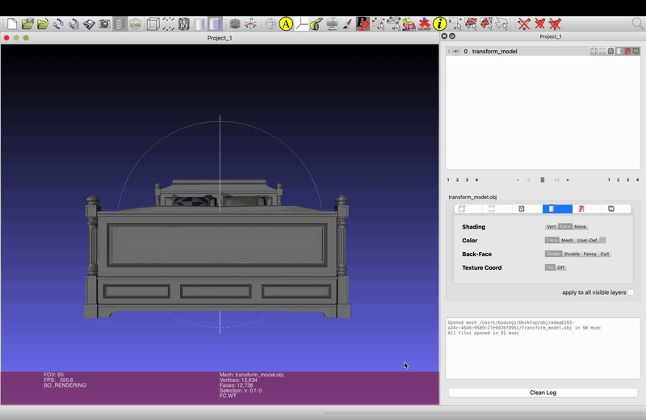

# Learning to Generate Text-guided 3D Canine-Object Interactions via Video Diffusion Priors

[](https://zerocoi.github.io/static/pdfs/paper.pdf)
[](https://zerocoi.github.io/static/pdfs/supp.pdf)
[](https://zerocoi.github.io/)

Siyu Chen, [Zan Wang](https://silvester.wang/), Hao Xu, Minghe Zhang, Mingtao Pei, [Wei Liang](https://liangwei-bit.github.io/web/)

This repository is the official implementation of the paper "Learning to Generate Text-guided 3D Canine-Object Interactions via Video Diffusion Priors."


## Abstract
Generating realistic 3D Canine-Object Interaction from text is crucial for scalable asset production and immersive experiences in games and virtual reality. Despite substantial advances in Human-Object Interaction generation, extending this success to Canine-Object Interaction generation remains challenging, primarily due to the scarcity of text–object–motion pairings and heterogeneous skeletal topologies in existing animal motion datasets. To tackle these issues, we propose ZeroCOI, a zero-shot learning framework that synthesizes Canine-Object Interaction from text prompts without relying on paired text–object–motion supervision. Our key insight is to harness the rich semantic knowledge and implicit physics priors encoded in large-scale video diffusion foundation models trained on diverse in-the-wild Canine-Object Interaction patterns. ZeroCOI first learns canine motion priors from a topology-unified dataset using a text-to-motion diffusion model. It then decouples canonical motion generation from spatial interaction placement, introducing a control branch that injects semantic and spatial interaction cues via distribution-level video-domain Score Distillation Sampling while encouraging physical plausibility through geometric constraints. Extensive experiments demonstrate that ZeroCOI enables semantically aligned and physically plausible Canine-Object Interaction synthesis from text prompts, with robust generalization to unseen object categories and geometries. Furthermore, extended applications illustrate the scalability of ZeroCOI across various scenarios, including cross-species extensions, human-canine interactions, and scene-level interactions, demonstrating the tremendous potential for the broad community.

## Installation

Clone ZeroCOI together with its third-party submodules:

```bash
git clone --recurse-submodules https://github.com/BIT-PIE/ZeroCOI.git
cd ZeroCOI
```

If the repository has already been cloned, initialize the submodules separately:

```bash
git submodule update --init --recursive
```

Create the Conda environment:

```bash
conda env create -f environment.yml
conda activate ZeroCOI
```

ZeroCOI uses the D-SMAL assets distributed by [BITE](https://github.com/runa91/bite_release). Follow the BITE data-preparation instructions and place the required model files under `BITE/data/smal_data/`.

## Data Preparation

Due to copyright restrictions on some data, we provide the complete preprocessing pipeline used to construct DogML3D.

### Motion Unification

Download [DigiDogs](https://cvssp.org/data/DigiDogs/), [AniMo4D](https://github.com/WandererXX/AniMo), and [AnimalML3D](https://github.com/USRC-SEA/OmniMotionGPT), then arrange the motion files as follows:

```text
dataset/
├── DigiDogs/
│   └── .../MotionSequence.bvh
├── AniMo4D/
│   ├── data_processed/
│   └── texts/
└── AnimalML3D/
    ├── animals_smal_joints/
    └── motion_captions/
```

We additionally annotate text descriptions for DigiDogs. Download them from [OneDrive](https://1drv.ms/f/c/0555FE6F828FCEEA/IgDz3NyrTx7OSpDFUywCTmWVAeitYfnCwjs_VvYOEN3J5jQ?e=SsC8Bc) and place the `texts` folder under `dataset/DigiDogs/`.

```bash
bash scripts/motion_unification.sh
```

This script retargets the three datasets to D-SMAL, generates the 428-dimensional motion representation and mirrored motions, and creates the data splits and training statistics under `dataset/DogML3D/`.

For rendering assets, use [SyncMVD](https://github.com/LIU-Yuxin/SyncMVD) to generate a textured D-SMAL mesh for each canine species and save it as `dataset/DogML3D/dog_textures/<SPECIES>/textured.obj`.

### Object Representation Precomputation

Prepare the object meshes in `dataset/DogML3D/obj/`. The [3D-FRONT](https://tianchi.aliyun.com/specials/promotion/alibaba-3d-scene-dataset) assets used in our experiments are listed in `preprocess/object_representation/3D_Front_list.txt`.

```bash
bash scripts/object_representation.sh
```

This script precomputes the Basis Point Set (BPS), height map, and signed distance field (SDF) for each object. For rendering during training, use MeshLab to bake the object textures into vertex colors and save the result as `transform_model.ply`.

[](assets/meshlab_vertex_color_baking.mov)

### Semantic Augmentation

```bash
export DASHSCOPE_API_KEY='<YOUR_DASHSCOPE_API_KEY>'
bash scripts/semantic_augmentation.sh
```

This script unifies the text-description format across the three datasets and randomly selects one to three objects for each description to perform object-aware semantic augmentation.

## Training

### Stage 1: Text-to-Motion Pretraining

```bash
bash scripts/train_t2m.sh <SAVE_DIR> <CHECKPOINT>
```

`SAVE_DIR` is the output directory. `CHECKPOINT` is the 50-step HumanML3D checkpoint released by [MDM](https://github.com/GuyTevet/motion-diffusion-model).

### Stage 2: Object-aware Finetuning

```bash
bash scripts/train_to2m.sh <SAVE_DIR> <CHECKPOINT>
```

Here, `CHECKPOINT` is the checkpoint produced by Stage 1. The default configuration uses [ZeroScope](https://huggingface.co/cerspense/zeroscope_v2_576w) as the video diffusion prior. To replace it with [VideoCrafter2](https://github.com/AILab-CVC/VideoCrafter), download its pretrained checkpoint and set `--vsd_cfg_src config_vc2.yaml` in `scripts/train_to2m.sh`.

## Inference

```bash
bash scripts/sample.sh <MODEL_PATH> <OUTPUT_DIR> [COND_MODE]
```

`COND_MODE` defaults to `text_obj` and supports the following options:

- `text`: generates canine motion conditioned only on the text description, without object conditioning or object rendering.
- `text_obj`: generates canine-object interaction conditioned on both the text description and the object, and renders the generated motion together with the object.

## Evaluation

```bash
bash scripts/eval.sh <MODEL_PATH>
```

Place the [pretrained text-motion evaluator](https://1drv.ms/u/c/0555FE6F828FCEEA/IQCss_DQ0eohQZpDbx0VB1rWAWgZaVSwa7S18I9MW2Nj5c8?e=c1Hb4g) at `text_mot_match/finest_aug.tar` before evaluation.

## Citation

If you find this project useful, please consider citing our paper:

```bibtex
@inproceedings{chen2026learning,
  title     = {Learning to Generate Text-guided 3D Canine-Object Interactions via Video Diffusion Priors},
  author    = {Chen, Siyu and Wang, Zan and Xu, Hao and Zhang, Minghe and Pei, Mingtao and Liang, Wei},
  booktitle = {SIGGRAPH Asia 2026 Conference Papers},
  year      = {2026},
  doi       = {10.1145/3829340.3842360}
}
```

## Acknowledgements

This codebase builds on [MDM](https://github.com/GuyTevet/motion-diffusion-model), [HumanML3D](https://github.com/EricGuo5513/HumanML3D), and [4D-fy](https://github.com/sherwinbahmani/4dfy).

## License

This project is licensed under the MIT License. See [LICENSE](LICENSE) for more details.
